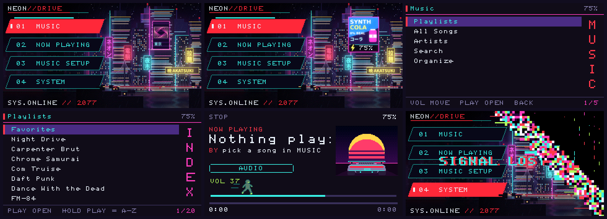
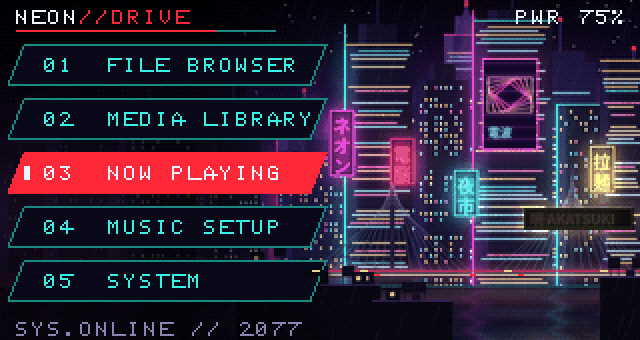
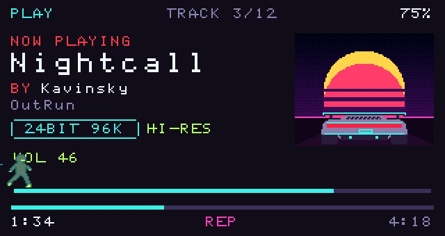
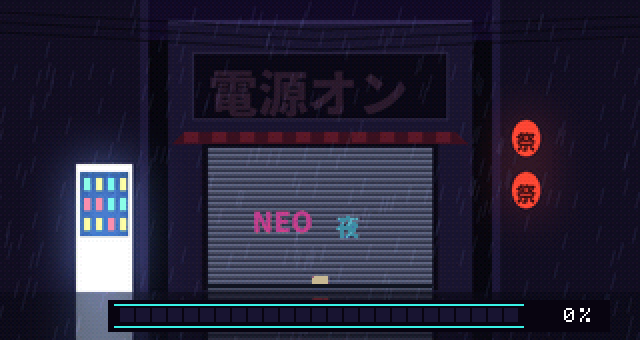
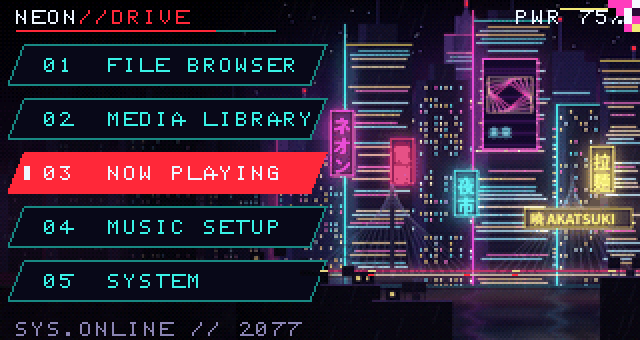
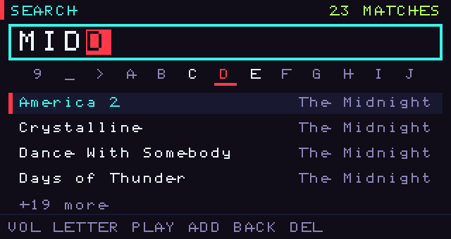
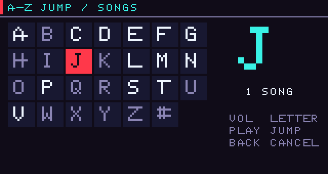

# NEON DRIVE — retrowave theme for the Snowsky Echo Mini

A full retrowave / cyberpunk makeover for the FiiO Snowsky **Echo Mini**:

- **Music that actually plays.** MP3s used to stutter and crawl: the decoder Core B used (minimp3) is floating point, and the Echo Mini's second core has no FPU, so every MP3 needed ~170 MIPS it doesn't have (and the old adapter also dropped frames). Neon Drive swaps in **libmad**, a fixed-point decoder: about **16 MIPS** for the same file, 10x less. FLAC and WAV were already fine.
- **Volume that does something.** The DAC tops out at 0 dB, but the old range kept counting up to +20 dB with no change in sound. The range is now 60 real steps, and the runner covers it exactly.
- **Night-city home screen.** A painted cyberpunk skyline (Tokyo / Bangkok / Chongqing vibes: towers, kanji neon, a river and a bridge full of traffic) next to Cyberpunk-style slanted menu tags: **MUSIC, NOW PLAYING, MUSIC SETUP, SYSTEM**. The selected tag glitches like a dying neon tube, signs stutter, headlights slide across the bridge.
- **Battery billboard.** Every other 10 seconds the main tower's hologram turns into a dumb ad (SYNTH-COLA, NEURO-GUM) carrying the battery %, with a lightning bolt while it charges. The battery % is now a real curve instead of 5 steps.
- **Boot animation.** A Japanese alley shop: the roll-up shutter lifts, the 電源オン ("power on") neon sign flickers to life, a neon loading bar fills.
- **Power-off animation.** Hold POWER: a glitchy "virus" eats the screen diagonally from top-right to bottom-left in 3 seconds, then the player switches off. Auto-off and the sleep timer use it too.
- **USB and charging screens.** A themed DATA LINK screen in USB drive mode, and a charging screen when it's switched off on the cable.
- **MUSIC menu.** Playlists, All Songs, Artists, Search, Organize. **Playlists** holds Favorites, your `.m3u8` playlists, and **every music folder** on the SD card / in Music as its own playlist. **Organize** has Albums, Genres, Years, Recently / Most played and Rebuild library.
- **Now Playing.** Long titles and artists scroll. `24/96K 1411KBPS` next to the sample rate. Optional **cover art** (MENU > Cover art). Volume and skip keep working even if a file won't play.
- **Quick settings (MENU).** Shuffle, Repeat, Cover art, **Sleep timer** (15/30/60/90 min), Playlist.
- **More EQ.** Bass Boost, Bass Max, Vocal Boost, Treble Boost, Loudness, Synthwave and Late Night presets, plus a simple 10-slider custom EQ. (Fixed: opening the preset list froze the player.)
- **Volume runner.** On Now Playing a glowing runner stands on the volume track and sprints left or right when you change it.
- **Search and A-Z jump.** MUSIC > Search: spin letters with VOL, add with PLAY. In any long list, **hold PLAY** for a letter grid.
- **PC tools.** A low-bitrate finder (songs under 192 kbps) and a cover-art maker.



| Home (live) | Volume runner |
|---|---|
|  |  |
| **Boot** | **Power off (hold POWER)** |
|  |  |
| **Search** | **A-Z jump (hold PLAY)** |
|  |  |

## Try it first: the simulator

Open **`simulator/index.html`** in any browser (phone works too; nothing to install). It runs ReChord's **actual firmware UI code**, compiled to WebAssembly: the same screens, theme engine and library index that run on the player, with a demo library of 122 synthwave tracks. Only the hardware is pretend: the buttons are on screen and there's no audio (songs "play" on a timer).

Buttons work like the real ones: hold PLAY for A-Z, and VOL repeats when held. On a computer you can use <kbd>↑</kbd>/<kbd>↓</kbd>, <kbd>Enter</kbd>, <kbd>Backspace</kbd> and <kbd>M</kbd>.

---

## Read this first

Neon Drive runs on **ReChord**, a community-built custom firmware for the Echo Mini (the Echo Mini can't run Rockbox). ReChord is new. It boots and plays on real players, but compared to the stock firmware:

| | Stock FiiO | ReChord + Neon Drive |
|---|---|---|
| FLAC, MP3, WAV | ✅ | ✅ |
| M4A/AAC, OGG, APE, DSD | ✅ | ❌ not yet |
| Bluetooth headphones | ✅ | ✅ (new in ReChord, still early) |
| USB DAC mode | ✅ | 🟡 early |
| 96 kHz files | ✅ | ✅ (rare crackle) |
| Copy music over USB | ✅ | ✅ internal storage (SD card is read-only over USB; use a card reader) |
| Themes / live wallpaper / runner | ❌ | ✅ |

**You can always go back.** Copy FiiO's official firmware file onto the player the same way and it returns to stock.

---

## Install (about 10 minutes)

**Before you start**

1. Back up any music on the player's internal storage (updates can wipe it).
2. Download the **official FiiO firmware** for your Echo Mini and keep it. That's your undo button: <https://fiio.com/newsinfo/1144405.html>
3. Take the **microSD card out**.
4. Charge the player above 50%.

**Step 1: firmware**

1. Plug the Echo Mini into your PC. It shows up as a drive.
2. Copy `STEP-1-FIRMWARE/HIFIEC90.IMG` to the **top level** of the player's drive (not inside a folder).
3. Eject the drive in Windows, unplug, and restart the player. It installs by itself; wait for it to boot.

**Step 2: theme**

1. Plug it back in. It shows up as a drive again (screen says *USB mass storage*).
2. Open `STEP-2-THEME`, copy the **`.rechord`** folder onto the top level of the player's drive, and click **Replace** if Windows asks.
3. Eject, unplug. Neon Drive loads on the next boot.

**Step 3: first boot**

1. On the home screen pick **MUSIC → Organize → Rebuild library** so the library finds your songs (do this again whenever you add music or playlists).
2. Put the microSD card back.

### Controls

| | |
|---|---|
| VOL + / − | move up / down through menus · change volume on Now Playing · spin letters in Search |
| PLAY | open / select · add a letter in Search · play/pause on Now Playing |
| hold PLAY | A-Z jump in lists · results in Search · add/remove Favorite on a song in an album or playlist |
| hold VOL + / − on Now Playing | next / previous song |
| BACK | go back (on the home screen: the classic ReChord menu) |
| MENU button | quick settings: shuffle, repeat, cover art, sleep timer, queue |
| Power, short press | screen off / on |
| Power, hold | power-off animation, then off |

The file browser moved into **SYSTEM** (it's still there, just off the home screen).

### Playlists

**Music > Playlists** shows, in this order:

1. **Favorites** (hold PLAY on a song inside an album or playlist to add or remove it).
2. **Playlist files**: `.m3u` / `.m3u8` (the kind iTunes, MusicBee, foobar2000 or VLC export) in a folder called **`Playlists`** at the top of the player or the SD card. Songs are matched to the copies already on the device, so nothing is duplicated.
3. **Every music folder**: each folder at the top of the SD card (or inside `SD/Music` / `Music` on the player) becomes a playlist with that folder's name, so music organized in folders shows up with nothing to set up.

After copying music or playlists: **Music > Organize > Rebuild library**.

### Cover art

The player can't decode JPEGs, so covers are prepared once on the PC: run **`cover-art-maker/Make Cover Art.bat`** with the player plugged in (needs Python 3). Then on the player: MENU > Cover art > on.

### Going back to stock

Copy the official FiiO `HIFIECxx.IMG` to the top level of the player, eject, restart. If the player ever won't boot at all, ReChord's recovery guide is here: <https://github.com/brnomt/FiioDcomp/blob/master/docs/FLASHING.md#recovery-if-something-goes-wrong>

---

## Low-bitrate finder

In `low-bitrate-finder/`:

- **Windows (nothing to install):** double-click **`Find Low Bitrate Songs.bat`** and pick your music folder, or drag the folder onto the .bat file.
- **Any OS:** `pip install mutagen`, then `python find_low_bitrate.py "path/to/music"`.

It writes `LowBitrate-Report.html` and a `.csv` to your Desktop: every song under 192 kbps, grouped by album with the worst first. It also lists files ReChord can't play yet (M4A/OGG and so on). It only reads files and never changes, moves or deletes anything.

---

## For tinkerers

```
src/                 theme sources (readable colours + comments)
tools/build_theme.py compiles src/ -> STEP-2-THEME/ and checks every ReChord limit
tools/make_assets.py the pixel-art sprites (car, palm, runner) -> 1-bit assets
art/build_art.py     paints the city + boot scenes -> img/*.565 (raw RGB565)
tools/previews.sh    re-renders docs/preview with the real engine
firmware/build.sh    rebuilds HIFIEC90.IMG: ReChord @ pinned commit + neon-drive-engine.patch
simulator/build.sh   rebuilds simulator/index.html (needs `pip install ziglang==0.13.0`, node)
```

The firmware patch (`firmware/neon-drive-engine.patch`) adds to ReChord:

- **Search** (`search_screen.c`, `mq_search_init`), **A-Z jump** (`az_screen.c`, `mq_initial_*`) and **playlists** (`mq_playlists_init`, `mq_playlist_init`), with host tests in `services/tests/test_search_az.c`.
- **Speed:** `fs_seek` no longer restarts the FAT cluster walk (seeks were quadratic), and the library index is verified once per mount instead of on every screen.
- **Smooth audio:** skins pump the Core B file ring while drawing, and animation frames are throttled/skipped while the ring is low.
- **Boot / power-off animations, USB and charging screens** (`startup/neon_fx.c`) streamed from the theme's `img/` folder.
- **Fixed-point MP3 on Core B:** libmad 0.15.1b (GPL-2.0+, vendored in `player/codecs/libmad/`) behind minimp3's API (`codecs/mp3_mad.c`); its 32 KiB requantization table is built in RAM at Core B boot, so Core B's image actually shrinks. Host tests: `player/tests/test_mp3_mad.c` (real Layer III stream, bit reservoir, table accuracy).
- **Fixes:** EQ preset picker overflowed a 16-row array (hard freeze), volume range clamped to the DAC's 0 dB, battery % from a Li-ion curve, volume/skip over a playback error.
- **Images in skins:** an `image` meter that streams raw RGB565 from the theme folder (no RAM), plus up to 6 partial-refresh regions.
- **EQ:** 7 new presets and a 10-slider graphic EQ screen; styled compiled menus.
- **Theme engine extras:** 2×/3× text, transparent text and sprites, mirrored sprites, colourable list selection bars, a `menu` home button, and the real battery level for skins (upstream always passed "unknown").

Themes that don't use the extras render exactly as before, and all of ReChord's test suites (UI, theme, services) pass with the patch. RAM use stays under ReChord's ceiling.

All art is original. ReChord is by [brnomt](https://github.com/brnomt/FiioDcomp). This project isn't affiliated with FiiO or Snowsky.
